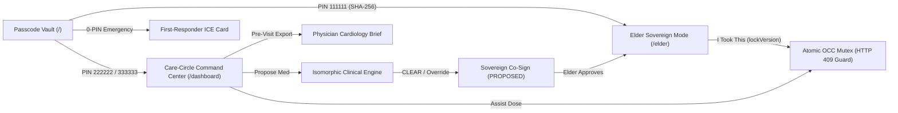

# AURA•CARE — Sovereign Elderly Care & Medication Co-Pilot

**Healthcare coordination that keeps dignity in the driver’s seat.**

- **GitHub Repository:** [https://github.com/prajyot-ship-it/aura_care-](https://github.com/prajyot-ship-it/aura_care-)
- **Live GitHub Pages Deployment:** [https://prajyot-ship-it.github.io/aura_care-/](https://prajyot-ship-it.github.io/aura_care-/)

---

## 1. Chosen Vertical
**Elderly Care & Medication Management Platform** — designed for older adults managing complex multi-drug regimens alongside family caregivers and home-care nurses.

---

## 2. Approach & Decision Logic

AURA•CARE replaces surveillance-heavy caregiver portals with an **agency-first, dual-mode architecture** powered by three isomorphic domain modules under `src/domain/`:

1. **Isomorphic Clinical Safety & Circadian Chelation Solver (`src/domain/clinical-engine.ts`):**
   - **NSAID + Factor Xa Anticoagulant Rule (`CRITICAL`):** Blocks or requires explicit clinical override when Ibuprofen, Naproxen, high-dose Aspirin, or any NSAID is proposed alongside Eliquis (`Apixaban`) or another anticoagulant due to >3× GI hemorrhage risk.
   - **Thyroid Hormone + Polyvalent Cation Chelation Rule (`WARNING`):** Uses 24-hour circular minute-distance math (`circularMinutesDistance`) across midnight wrap-around to enforce a **±240-minute (4-hour) duodenal absorption buffer** around Levothyroxine (`06:30 AM` → forbidden `02:30–10:30` window for Calcium Carbonate, Iron, Magnesium, or Multivitamins) and automatically suggests a safe midday window (`>= 10:30` / `12:30 PM`).
   - **Duplicate Therapeutic Class Rule (`WARNING`):** Flags overlapping drug classes (e.g., Simvastatin alongside Atorvastatin).
2. **Atomic Double-Dose Mutex & Sovereign Co-Sign State Machine (`src/domain/dose-mutex.ts`):**
   - **Optimistic Concurrency Control (`lockVersion`):** Every dose confirmation (`TAKEN`, `SNOOZED_15M`, `SKIPPED`) checks `expectedLockVersion === currentDose.lockVersion`. Stale concurrent attempts throw a typed `MutexConflictError` (`HTTP_409_CONFLICT`) citing the winning caregiver and timestamp.
   - **Sovereign Co-Sign:** Caregiver-proposed medications enter `PROPOSED` / `PENDING_ELDER_APPROVAL` and remain excluded from the active daily schedule until the elder explicitly transitions them via `approveProposedMedication()` (`ELDER_APPROVED`) or `holdProposedMedication()` (`HELD_FOR_MD`).
3. **Runtime Schema & Cryptographic Hardening (`src/domain/schemas.ts`):**
   - `safeHydrateState()` strips prototype-pollution vectors (`__proto__`, `constructor`, `prototype`) and validates persisted `localStorage` payloads with `VaultStateSchema` (Zod).
   - `verifyVaultPin()` hashes 6-digit PINs via Web Crypto `crypto.subtle.digest("SHA-256", ...)` and compares hex digests in constant time—zero plaintext PIN literals in runtime auth logic.

---

## 3. How the Solution Works



### Demo Credentials (CareVault `AURA-7842`)

| Role | 6-Digit PIN | Destination Route | Key Capabilities |
| :--- | :---: | :--- | :--- |
| **Arthur Pendelton** (Elder Sovereign) | `111111` | `/elder/` | `64px+` tactile targets, Voice Co-Pilot, Shake-to-Calm Stabilizer, 3D Pill Twin + AR Camera Verifier, Sovereign Co-Sign |
| **Maya Pendelton** (Primary Caretaker) | `222222` | `/dashboard/` | 3D Circadian Orbital Ring, 14-day Heatmap, Polypharmacy Guardrails, Pharmacist QR Passport, Email Outbox |
| **David Ortiz, RN** (Home Care Nurse) | `333333` | `/dashboard/` | Assisted dose administration, Atomic HTTP 409 Mutex testing, Clinical Brief generation |
| **First-Responder / Paramedic** | *No PIN* | `/` or `/elder/` | Zero-PIN **Emergency Medical ID (ICE)** card (Eliquis hemorrhage alert, allergies, blood type `O+`) |

### Local & Static Quick Start

```bash
npm install
npx prisma generate
npx prisma db push
npx prisma db seed
npm run dev
```

Open `http://localhost:3000`. On static GitHub Pages (`GITHUB_PAGES=true npm run build`), `src/lib/clientVaultFallback.ts` transparently executes the exact same isomorphic domain modules (`src/domain/`) in the browser via validated `localStorage` persistence with zero failed `/api/*` network calls.

---

## 4. Assumptions Made
- **Static Export Persistence:** In the GitHub Pages deployment (`output: "export"`), there is no Node.js/SQLite server; `clientVaultFallback.ts` persists state per-browser in `localStorage` under Zod validation (`safeHydrateState`).
- **Hardware & Browser Permissions:** When webcam (`getUserMedia`) or Web Speech (`SpeechRecognition`) APIs are unavailable or denied, AURA•CARE gracefully degrades to an optical AR reticle simulator and 1-tap voice intent triggers.
- **Clinical Dataset Scope:** The polypharmacy engine encodes high-severity geriatric drug-drug and chelation rules tailored to Arthur Pendelton’s active cardiology/endocrine regimen (`Eliquis`, `Levothyroxine`, `Lisinopril`, `Atorvastatin`) as a deterministic clinical decision-support prototype.

---

## 5. Testing & Quality Verification

- **Unit & Integration Suite (`npm run test:coverage`):** Vitest + React Testing Library + `@vitest/coverage-v8` covering `src/domain/clinical-engine.ts`, `src/domain/dose-mutex.ts`, `src/domain/schemas.ts`, and `AccessibleModal` portal/keyboard trapping (`>97%` line coverage, `100%` function coverage).
- **End-to-End & WCAG 2.1 AA Suite (`npm run test:e2e`):** Playwright + `@axe-core/playwright` testing the full Vault → Elder → Co-Sign → Dose Mutex flow, Zero-PIN ICE modal geometry, Care-Circle Ibuprofen/Calcium guardrails, HTTP 409 conflict verification, Physician Brief rendering, and zero critical/serious `axe-core` violations across all routes.
- **Strict TypeScript & Zero-Warning Lint:** `tsc --noEmit` (`strict`, `noUncheckedIndexedAccess`, `noImplicitOverride`) + `next lint --max-warnings=0`, enforced on every push to `main` via `.github/workflows/deploy.yml`.
